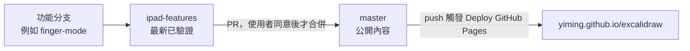

# 2026-10-26 分支與發布

`ipad-features` 是整合分支。`master` 是發布分支，不是開發分支。

## ipad-features

每項功能各自開分支開發並測試，例如 `finger-mode`。通過後合回 `ipad-features`。這條分支保持最新、已驗證的狀態。

## master

`master` 落後 `ipad-features`，上面放的是 Pages 公開看得到的內容。不在 `master` 上開發。

使用者曾把發布分支叫成 Cursor Deploy GitHub Pages。實際跑部署的是 `master` 上的 [`.github/workflows/deploy-pages.yml`](../.github/workflows/deploy-pages.yml)：推上 `master` 會部署，也可以 `workflow_dispatch`。網站是 https://yiming.github.io/excalidraw/ 。

`cursor/deploy-github-pages-339e` 不是發布分支。它是今天 cloud agent 為了開 [PR #1](https://github.com/yiming/excalidraw/pull/1) 才建立的來源分支。PR #1 已合併進 `master`，這條分支可以視為留下來的。

## 發布

把 `ipad-features` 合併進 `master` 要開 PR，使用者同意後才合併。推上 `master` 會跑上述 workflow，並更新 https://yiming.github.io/excalidraw/ 。

目前這張 PR 是 draft：[PR #2](https://github.com/yiming/excalidraw/pull/2)。尚未合併。

## 今天的 Pages workflow

Pages 部署 workflow 是今天由 cloud agent 經 [PR #1](https://github.com/yiming/excalidraw/pull/1) 加進 `master` 的。
